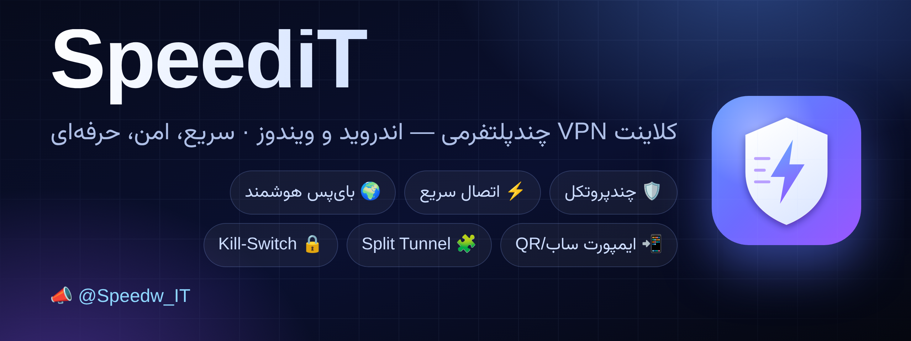

<p align="center">
  
</p>

<p align="center">
  <b>SpeediT</b> — a fast, secure, multi-protocol VPN client for <b>Android</b> and <b>Windows</b>.
</p>

<p align="center">
  <a href="https://t.me/Speedw_IT"></a>
  
  
  
</p>

<p align="center"><a href="README.md">فارسی</a> · <b>English</b></p>

---

## ✨ Features

- 🛡️ **Multi-protocol:** VLESS (+Reality) · VMess · Trojan · Shadowsocks — plus the sing-box core on Windows.
- ⚡ **Fast, stable connection** with live up/down speed and session timer.
- 📲 **Easy import:** subscription URL, QR, clipboard, or manual config.
- 🔄 **Auto-updating subscriptions**, multiple subs at once.
- 📊 **Ping all servers** and sort by quality.
- 🌍 **Smart routing:** bypass LAN/private IPs, TUN or proxy-only mode.
- 🧩 **Split tunnel** (Android): choose which apps bypass the VPN.
- 🎨 **Polished UI:** dark/light themes, Persian & English (full RTL).
- 🔒 Privacy-first: no logs, everything stays on your device.

## ⬇️ Download

Grab the latest build from **[Releases](../../releases)**:
- `SpeediT-android-arm64-v8a.apk` (most phones)
- `SpeediT-android-armeabi-v7a.apk` (older phones)
- `SpeediT-windows-x64.zip` (Windows 64-bit)

## 🧭 Quick start

1. Install and open the app.
2. Go to **Subscriptions** → **Add subscription** and paste your sub URL (or scan a QR).
3. Pick a server under **Servers** (try “Ping all”).
4. On **Home**, tap the big connect button.

> **Windows:** full VPN (TUN) mode needs the app to run as **Administrator**; the bundled `sing-box` core ships in the `core/` folder next to the app.

## 🏗 Build from source

Official builds are produced automatically by **GitHub Actions** (Android on a Linux runner, Windows on a Windows runner). Locally:

```bash
flutter create . --org com.speedit --project-name speedit --platforms=android,windows
bash tool/apply_overlay.sh         # Android only
flutter pub get
dart run flutter_launcher_icons
flutter build apk --release        # Android
flutter build windows --release    # Windows (on Windows)
```

The `android/` and `windows/` folders are intentionally not committed — they are regenerated by `flutter create` so they always match your Flutter version.

## 🧱 Architecture

| Platform | Core | Mode |
|----------|------|------|
| Android | Xray (`flutter_v2ray`) | VpnService (real TUN) |
| Windows | `sing-box` (sidecar) | TUN (requires Administrator) |

## 📣 Contact

Channel & support: **[@Speedw_IT](https://t.me/Speedw_IT)** · Developer: **Speed iT**

## 📄 License

MIT — see [`LICENSE`](LICENSE).
