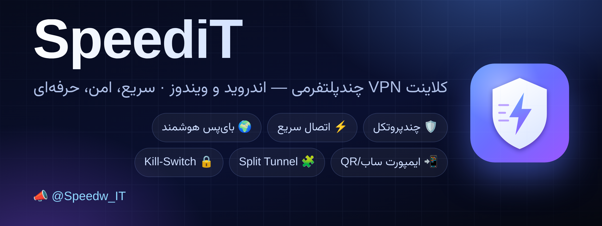

<p align="center">
  
</p>

<p align="center">
  <b>SpeediT</b> — کلاینت VPN سریع، امن و چندپروتکلی برای <b>اندروید</b> و <b>ویندوز</b>.
</p>

<p align="center">
  <a href="https://t.me/Speedw_IT"></a>
  
  
  
</p>

<p align="center"><b>فارسی</b> · <a href="README.en.md">English</a></p>

---

## ✨ ویژگی‌ها

- 🛡️ **چندپروتکلی:** VLESS (+Reality) · VMess · Trojan · Shadowsocks — و در ویندوز از طریق هسته‌ی sing-box.
- ⚡ **اتصال سریع و پایدار** با نمایش زنده‌ی سرعت آپلود/دانلود و مدت اتصال.
- 📲 **ایمپورت آسان کانفیگ:** لینک اشتراک (ساب)، QR، کلیپ‌بورد یا افزودن دستی.
- 🔄 **به‌روزرسانی خودکار اشتراک‌ها** و مدیریت چند ساب هم‌زمان.
- 📊 **تست پینگ همه‌ی سرورها** و مرتب‌سازی کیفیت.
- 🌍 **روتینگ هوشمند:** بای‌پس شبکه‌ی داخلی/LAN، مود TUN یا فقط‌پروکسی.
- 🧩 **Split Tunnel** (اندروید): انتخاب اینکه کدام اپ‌ها از VPN رد شوند.
- 🎨 **ظاهر حرفه‌ای:** تم تیره/روشن، فارسی و انگلیسی (RTL کامل).
- 🔒 حریم خصوصی: بدون لاگ، همه‌چیز محلی روی دستگاه.

## ⬇️ دانلود

آخرین نسخه‌ها در بخش **[Releases](../../releases)**:
- `SpeediT-android-arm64-v8a.apk` (بیشتر گوشی‌ها)
- `SpeediT-android-armeabi-v7a.apk` (گوشی‌های قدیمی‌تر)
- `SpeediT-windows-x64.zip` (ویندوز ۶۴ بیتی)

## 🧭 شروع سریع

1. اپ را نصب و باز کنید.
2. به بخش **اشتراک‌ها** بروید → **افزودن اشتراک** و لینک ساب خود را وارد کنید (یا QR را اسکن کنید).
3. از بخش **سرورها** یک سرور انتخاب کنید (می‌توانید «تست پینگ همه» را بزنید).
4. در صفحه‌ی **خانه**، دکمه‌ی بزرگ اتصال را لمس کنید.

> **ویندوز:** برای مود کامل VPN (TUN) اپ باید با دسترسی **Administrator** اجرا شود؛ هسته‌ی `sing-box` همراه اپ در پوشه‌ی `core/` قرار دارد.

## 🏗 ساخت از روی سورس

بیلدهای رسمی به‌صورت خودکار با **GitHub Actions** ساخته می‌شوند (اندروید روی رانر لینوکس، ویندوز روی رانر ویندوز). برای ساخت محلی:

```bash
flutter create . --org com.speedit --project-name speedit --platforms=android,windows
bash tool/apply_overlay.sh         # فقط برای اندروید لازم است
flutter pub get
dart run flutter_launcher_icons
flutter build apk --release        # اندروید
flutter build windows --release    # ویندوز (روی ویندوز)
```

پوشه‌های `android/` و `windows/` عمداً در ریپو نیستند و با `flutter create` ساخته می‌شوند تا همیشه با نسخه‌ی Flutter هماهنگ بمانند.

## 🔑 امضا (اختیاری)

APK ریلیز به‌صورت پیش‌فرض با کلید دیباگ امضا می‌شود تا قابل نصب باشد (برای توزیع خارج از Google Play کافی است). برای امضای حرفه‌ای با کلید خودتان، کی‌استور را به‌صورت Secret در گیت‌هاب اضافه کنید و signingConfig را تنظیم کنید. برای ویندوز، گواهی Code-Signing (ترجیحاً EV) جلوی هشدار SmartScreen را می‌گیرد.

## 🧱 معماری

| پلتفرم | هسته | مود |
|--------|------|-----|
| اندروید | Xray (`flutter_v2ray`) | VpnService (TUN واقعی) |
| ویندوز | `sing-box` (sidecar) | TUN (نیازمند Administrator) |

## 📣 ارتباط

کانال و پشتیبانی: **[@Speedw_IT](https://t.me/Speedw_IT)** · سازنده: **Speed iT**

## 📄 لایسنس

MIT — فایل [`LICENSE`](LICENSE).

<p align="center"><sub>Made with 💙 by <a href="https://t.me/Speedw_IT">@Speedw_IT</a></sub></p>
